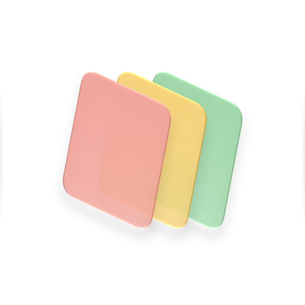
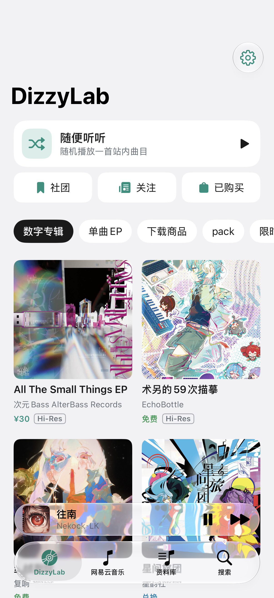
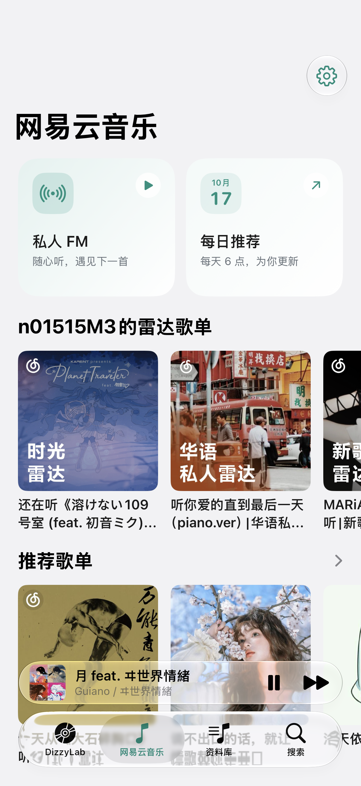
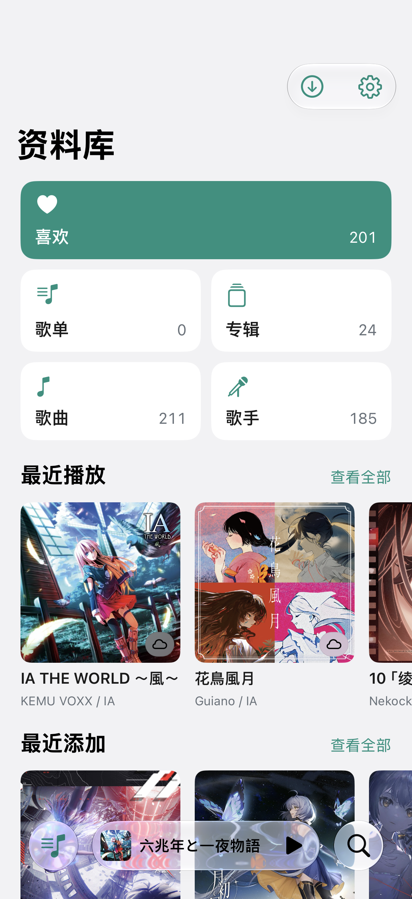
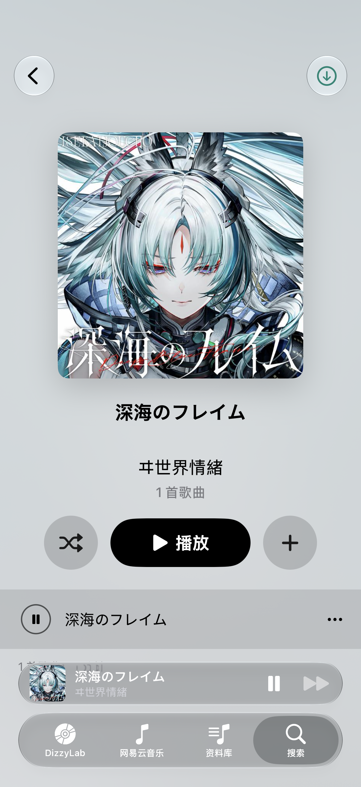
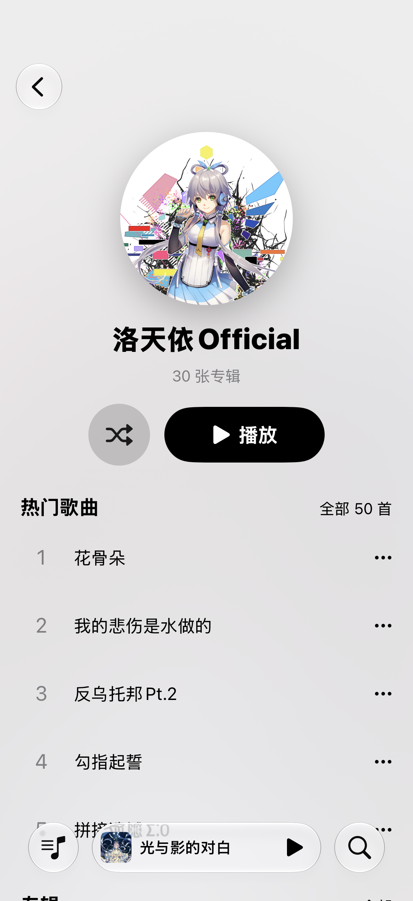
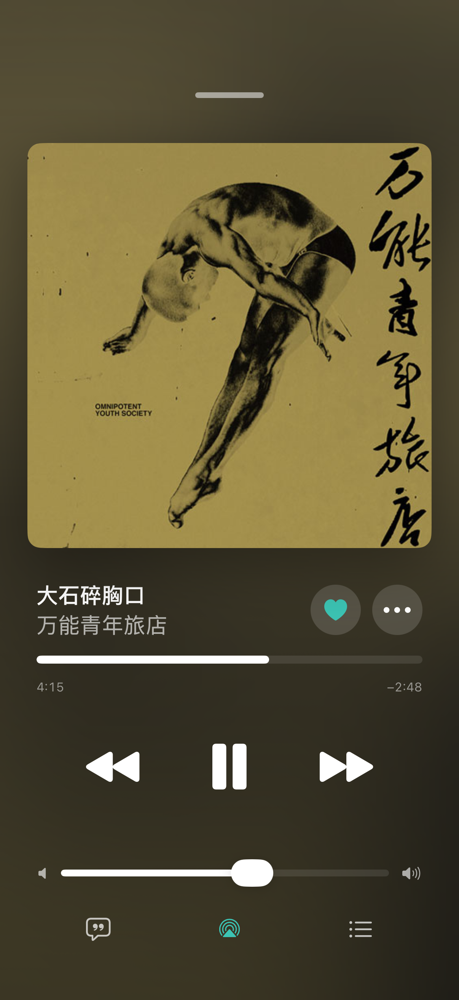

<div align="center">



# NeoDizzy

**把 DizzyLab、网易云音乐、QQ 音乐与本地收藏，放进同一个音乐 App。**

为 iPhone 打造 · SwiftUI 原生界面 · 统一资料库与搜索 · 在线与离线播放

[](https://github.com/Fab1e2000/NeoDizzy/releases/latest)
[](https://github.com/Fab1e2000/NeoDizzy/releases)
[](https://github.com/Fab1e2000/NeoDizzy/actions/workflows/ci.yml)
[](#安装)
[](https://developer.apple.com/xcode/swiftui/)
[](LICENSE)

[界面预览](#界面预览) · [功能](#功能亮点) · [下载与安装](#安装) · [从源码构建](#从源码构建) · [更新日志](docs/releases) · [反馈问题](https://github.com/Fab1e2000/NeoDizzy/issues)

</div>

## 关于 NeoDizzy

NeoDizzy 是一款独立开发的第三方音乐客户端。你可以在 DizzyLab 发现同人音乐，在网易云音乐收听私人 FM、每日推荐与歌单，也可以播放自己保存的本地音乐。歌曲、专辑、歌单和歌手汇集到统一资料库，跨来源搜索、喜欢与播放都有一致的入口。

界面使用原生 SwiftUI，提供浅色与深色外观、多种主题色及对应应用图标。全屏播放器以专辑封面为中心，配合封面取色背景、歌词与待播清单；迷你播放器让你在浏览时继续控制播放。

> [!NOTE]
> 当前开发重点为 iPhone。自 **v0.5.0** 起暂停 macOS 开发与发布，新版仅提供 IPA；macOS 源码与历史 Release 保留。

> [!IMPORTANT]
> NeoDizzy 与 DizzyLab、网易云音乐、QQ 音乐及其运营方不存在隶属、合作或授权关系。内容访问、完整播放和下载受平台账号权限限制。使用前请阅读 [免责声明](DISCLAIMER.md)，尊重创作者与内容版权。

## 界面预览

以下为 iPhone 实机截图，使用青绿色主题。应用默认图标为上方的白底青瓷互扣双环。

<table>
  <tr>
    <td align="center" width="33%"><br><strong>DizzyLab</strong></td>
    <td align="center" width="33%"><br><strong>网易云音乐</strong></td>
    <td align="center" width="33%"><br><strong>统一资料库</strong></td>
  </tr>
  <tr>
    <td align="center"><br><strong>专辑详情</strong></td>
    <td align="center"><br><strong>歌手详情</strong></td>
    <td align="center"><br><strong>正在播放</strong></td>
  </tr>
</table>

## 功能亮点

### 三个平台，一套浏览体验

- **DizzyLab**：浏览数字专辑、单曲 EP、下载商品、pack 与限时优惠；发现社团、查看关注动态和已购作品，也可通过「随便听听」随机播放站内曲目。
- **网易云音乐**：私人 FM、每日推荐、推荐歌单与排行榜；浏览歌曲、专辑、歌单和歌手，登录后同步账号内容。
- **QQ 音乐**：猜你喜欢、每日30首、雷达、推荐歌单与榜单；歌曲／专辑／歌单／歌手搜索，歌手目录与新碟；官方网页登录、账号喜欢与收藏、加入歌单、单曲及集合下载、统一音质与翻译歌词。基于 QQMusicApi 原生接入，访问和音质以账号权限为准。
- **统一搜索**：按来源展示本地资料库、DizzyLab、网易云音乐与 QQ 音乐的结果，支持查看全部、最近搜索和失败重试。

### 统一资料库

- **喜欢、歌单、专辑、歌曲与歌手**：集中浏览本地音乐和平台账号内容，查看最近播放与最近添加。
- **一致的歌曲操作**：从列表、详情或播放器喜欢歌曲、取消喜欢、加入歌单；网易云歌曲使用账号歌单，本地文件使用本地歌单。
- **账号同步**：汇总网易云歌单与收藏专辑、DizzyLab 已购专辑，在启动、回到前台、下拉刷新及账号操作后更新。
- **管理与导出**：在设置中管理来源账号与资料库，支持资料库导出。本地歌单以 M3U8 文件保存。

### 播放与歌词

- **全屏与迷你播放器**：大封面、封面取色背景、喜欢、播放进度、音量、AirPlay 和待播清单。
- **后台与锁屏控制**：支持播放、暂停、切歌与进度调整，保存播放队列、模式和进度；可用本地音频优先播放。
- **连续播放**：提前准备下一首，由系统播放队列自动衔接；支持顺序、随机和循环播放。在线音频仍取决于网络缓冲，音源自身的静音不会被裁掉。
- **歌词**：网易云歌曲可读取平台歌词；本地音乐支持 LRC / TXT、同名歌词文件与音频内嵌歌词，支持逐行同步和点击跳转。检测到可用歌词后，全屏播放器才显示歌词按钮。
- **外观与导航**：浅色、深色及跟随系统，多种主题色与应用图标；在设置中调整启动页面和模块顺序。

### 下载与本地音乐

- **DizzyLab 下载**：下载账号已购作品，解压专辑与特典并保留曲目对应关系。
- **网易云下载**：按账号权限获取完整歌曲，支持音质回退、NCM 解码和元数据写入；不将试听片段作为完整版保存。
- **下载队列**：管理任务与并发，支持将歌单下载为本地音乐及本地歌单。
- **本地文件**：读取 MP3、M4A/AAC/ALAC、FLAC、WAV、AIFF 和 CAF 等系统支持的音频，识别曲序、分碟、歌手与封面。
- **标签编辑**：编辑支持格式的标题、歌手、专辑、曲号、碟号和封面，支持 FLAC 批量编辑，不重新编码音频。

### DizzyLab 购买与社区

- 数字专辑购买与 BOOST，通过支付宝收银台付款，返回后核验到账。
- 专辑 +dB、短评发表与删除、repo 长评及图片阅读、用户主页。
- 本机保存专辑浏览记录，支持重访、删除和清空。

## 安装

需要 **iPhone，iOS 27.0 或更高版本**。当前为竖屏界面。

1. 从 [最新 Release](https://github.com/Fab1e2000/NeoDizzy/releases/latest) 下载 `NeoDizzy-vX.Y.Z-unsigned.ipa`。
2. 使用自己的证书或侧载工具重新签名，安装到 iPhone。

IPA 未签名，不包含开发者证书或描述文件，不能直接点击安装。本次不提供 macOS 安装包，旧版可在 [历史 Release](https://github.com/Fab1e2000/NeoDizzy/releases) 中查找。

## 使用本地音乐

音乐文件保存在 **「文件 › 我的 iPhone › NeoDizzy」**，无需授权外部文件夹。你可以在「文件」App 中拖入音乐，也可通过电脑访达的文件共享复制，或从其他 App 的分享菜单选择「用 NeoDizzy 打开」歌曲与 ZIP 压缩包。

切回 App 时自动扫描，也可在资料库下拉刷新。普通本地音乐按文件夹组织专辑；下载专辑保留平台曲目信息。扫描不改写音频，标签编辑仅在明确保存时写入。移动或删除文件后，请重新扫描。

音乐文件保存在本机，删除 App 会一并删除，请提前备份。

## 从源码构建

需要 **Xcode 27**；工程使用 Swift 5 语言模式。修改工程配置时还需安装 [XcodeGen](https://github.com/yonaskolb/XcodeGen)。

```sh
git clone https://github.com/Fab1e2000/NeoDizzy.git
cd NeoDizzy
scripts/setup.sh
open NeoDizzy.xcodeproj
```

在 `Config/Signing.local.xcconfig` 中填写自己的开发团队 ID，选择 `NeoDizzy` Scheme 与 iPhone 或模拟器运行。首次构建会解析 AudioTags、SwiftSoup、Nuke 和 ZIPFoundation 等依赖。

```sh
scripts/simulator.sh run    # 构建并启动 iOS 模拟器
scripts/simulator.sh test   # 完整 iOS 测试
python3 scripts/test-core.py # 核心回归测试
scripts/package-unsigned.sh # 未签名 IPA，输出到 dist/
```

真机部署可复制 `.env.example` 为 `.env`，填写设备配置后运行 `scripts/deploy-device.sh Release`。签名配置与设备信息不入库。使用独立的 Bundle ID，避免覆盖其他应用。

工程配置由 `project.yml` 管理，修改后运行 `xcodegen generate`。源代码使用 Xcode 同步文件夹，新增 Swift 文件无需重新生成工程。macOS target 保留供参考，目前不参与新版构建与验收。

## 测试与发布

GitHub Actions 在 PR 中执行核心回归、iOS 模拟器测试及设备版 IPA 构建。推送 `v*` 标签后，检查通过即自动发布 **仅含未签名 IPA** 的 Release。

发版需保持 iOS App 与 Widget 的版本号一致，并提供 `docs/releases/vX.Y.Z.md`。自动化测试与模拟器运行不能代替实际账号、付款、真机后台播放和侧载签名验收。

## 文档

| 文档 | 内容 |
| --- | --- |
| [使用说明](docs/MANUAL.md) | 图标含义、缓存与下载、备份等使用规则 |
| [更新日志](docs/releases) | 版本改动与安装说明 |
| [模块说明](docs/modules.md) | 来源模块与应用结构 |
| [项目规划](docs/PLAN.md) | 实现与验收记录 |
| [网站接口](docs/SITE_API.md) | DizzyLab 接口与解析约定 |
| [第三方声明](THIRD_PARTY_NOTICES.md) | 依赖和参考项目的来源、许可证 |
| [免责声明](DISCLAIMER.md) | 平台关系、内容权利与使用责任 |

## 已知限制

- 平台接口可能变化；推荐、收藏、完整播放与下载取决于实际账号权限和服务端状态。
- 部分购买流程、注册、找回密码及 repo 回复仍需使用网站。
- 本地音乐不提供联网匹配或 CUE 整轨分曲；不支持编辑受保护或损坏的音频文件。
- 暂无均衡器、AutoMix、灵动岛或 Apple Watch 版本。
- macOS 开发与发布暂停，历史版本功能不保证与当前 iOS 一致。

## 参与项目

欢迎通过 [Issues](https://github.com/Fab1e2000/NeoDizzy/issues) 反馈问题。请附系统版本、App 版本和复现步骤，避免上传登录凭据、付款链接或其他私人信息。提交 PR 前请确认工程可构建并通过相关测试。

## 许可证与致谢

NeoDizzy 以 [GNU GPLv3](LICENSE) 发布。此许可证不授予任何平台内容、商标或服务的权利；音乐、封面和社区内容的版权归各自权利人所有。请支持创作者，按平台规则使用音乐，勿重新上传或公开分发无权传播的内容。

- [MeloX](https://github.com/youshen2/MeloX) / MeloX_Modified：播放队列、系统媒体控制、播放器界面、专辑页容器与封面背景等功能的来源或参考，按 GPL-3.0 适配。
- [NeoBili](https://github.com/Fab1e2000/NeoBili)：界面组织、立体字母图标与 README 排版参考。
- [SwiftSoup](https://github.com/scinfu/SwiftSoup)：HTML 解析。
- [Nuke](https://github.com/kean/Nuke)：封面加载与缓存。
- [ZIPFoundation](https://github.com/weichsel/ZIPFoundation)：ZIP 解压。

具体来源与许可证见 [THIRD_PARTY_NOTICES.md](THIRD_PARTY_NOTICES.md)。
