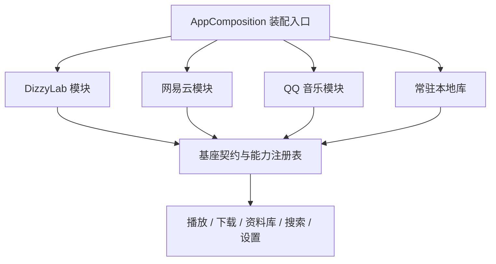

# 模块关系与实际源码删除验证（2026-10-23）

结论：iOS 的三个平台模块已通过独立删除验证。除唯一装配入口外，基座不引用平台实现类型；平台之间不引用彼此的实现。模块依赖基座的公共契约、模型和服务，当前仍是同一 target 中的静态模块，不是动态二进制插件或独立 Swift Package。

## 所有权与依赖方向

| 层 | 所有权及接入规则 |
| --- | --- |
| 装配入口 | `AppComposition` 唯一列举内置平台；每个平台独立一行注册。旧下载迁移通过注册契约提供，不再直接调用某个平台。 |
| 平台模块 | `Core/Modules/<平台>` 和 `Features/Modules/<平台>` 包含该平台的网络、账号、缓存、模型、路由、页面和适配器。平台之间无直接引用。 |
| 基座 | 播放器、下载队列、本地文件、资料库、喜欢、历史、搜索容器、设置和通用 UI；通过 `AppModule`、`PlatformRegistration`、`PlatformRuntime` 及各能力注册表交互。 |
| 历史数据兼容 | 旧曲目来源、账号镜像字段、网易云旧目录、旧导航偏好等保留在基座，只处理本机数据；平台不存在时仍可读取历史本地文件。 |
| 测试 | 基座测试独立保留；平台测试随平台移除；双平台集成测试明确登记两个依赖，只有任一依赖缺失时才移除。 |



本轮实际修复了这些残留依赖：

- 将散落的 58 个 DizzyLab 独有文件移入平台目录，保留通用模型、UI、Keychain 和离线能力。
- 网易云与 QQ 不再借用 DizzyLab 的专辑模型和卡片；共享 `CoverCard`。将被网易云使用的长文本组件抽到基座。
- 路由及平台 ID 扩展归入各自模块。基座导入器直接使用 `LibraryManifest`，不再使用 DizzyLab 的类型别名。
- 移除依赖特定平台的旧 `StreamResolver` 兼容扩展，测试通过明确注册 provider 注入能力。
- 拆分测试中的旧别名、平台路由、搜索模型和双平台依赖；清理移动文件后残留的 Xcode 空目录成员引用。
- 修正旧导航迁移对全局模块列表的依赖，改用实际传入的已安装模块列表。

## 四组最终结果

四组均从同一当前工作区输入生成独立快照，实际删除对应平台代码和依赖它的测试；完整运行全部保留测试，没有使用 `only-testing` 或 `skip-testing` 过滤。

| 实际删除 | 删除产品 Swift 文件数 | 保留并启用 | 通过 | 失败 | 跳过 |
| --- | ---: | --- | ---: | ---: | ---: |
| DizzyLab | 77 | 网易云、QQ 音乐、本地库 | 487 | 0 | 1 |
| 网易云 | 31 | DizzyLab、QQ 音乐、本地库 | 561 | 0 | 1 |
| QQ 音乐 | 28 | DizzyLab、网易云、本地库 | 473 | 0 | 1 |
| 全部平台 | 136 | 仅本地库与基座 | 273 | 0 | 1 |

累计 1,794 项通过、0 失败。各组的唯一跳过项都是既有的 `LocalLibraryTests.verifiesUserMusicReadOnly()`：它需要 `NEODIZZY_VERIFY_MUSIC_ROOT` 指向用户真实音乐目录，当前模拟器未提供该输入。测试框架自动跳过，没有按模块关闭测试。

每组还核实了：

- 被移除模块的源码确实不存在，没有占位实现或模块条件编译开关。
- 基座与保留模块的文件 SHA-256、目录清单保持一致；只允许删除注册行和相应 Xcode 文件归属元数据。
- `ModuleRemovalContractTests` 在真实测试进程中输出预期与实际模块集合，并严格比较；保留模块全部启用，首页、搜索、账号、下载、资料库入口均可取得。
- 通用契约测试覆盖 0／1／2 个在线来源、停用、重新装配、缓存与本地数据保留、撤销指定来源后另一来源继续可用。
- 四个 App 均成功启动并查看截图：仅显示保留模块、本地库和搜索；只保留基座时，底栏仅有资料库与搜索。

当前产品和测试源码与本轮输入一致。输入清单指纹：`5a1e8b7aa5fc936290d0780cfb420f0e338d703cb478100de620929dd5adab8e`。

## 证据与复现

[机器可读汇总](module-removal-2026-10-23.json)；本机完整证据根目录：`/tmp/neodizzy-removal-20261023-v5`。每组 `artifacts` 中包含 Xcode 日志、`Tests.xcresult`、`result.json`、实际运行环境验证及 `launch.png`；`removal-manifest.json` 包含删除清单和文件哈希。

[模块归属清单](../../scripts/module-removal-manifest.json)、[源码删除工具](../../scripts/test-module-removal.py)、[边界检查](../../scripts/check-module-boundaries.py)。边界检查覆盖 269 个产品文件（装配入口单独豁免）及 90 个测试文件，包含类型别名、actor 与测试归属；测试工具的 11 项安全自测通过。主工程全部平台的 `build-for-testing` 也成功。

```sh
python3 scripts/check-module-boundaries.py
python3 scripts/test-module-removal-harness.py
python3 scripts/test-module-removal.py --case all --output-root /tmp/my-removal-check --prepare-only
# 各组使用独立模拟器，可并行执行：
python3 scripts/test-module-removal.py --case remove-qqmusic \
  --output-root /tmp/my-removal-check --run-prepared \
  --destination 'platform=iOS Simulator,id=<SIMULATOR_UUID>' --jobs 2
```

验证范围为 iOS 源码删除、完整保留测试及启动冒烟。接口与账号行为主要通过确定性测试验证；本轮未逐项执行真实账号写入、会员权限和长时间听音验收。macOS 旧界面装配不属于本轮验收范围。
